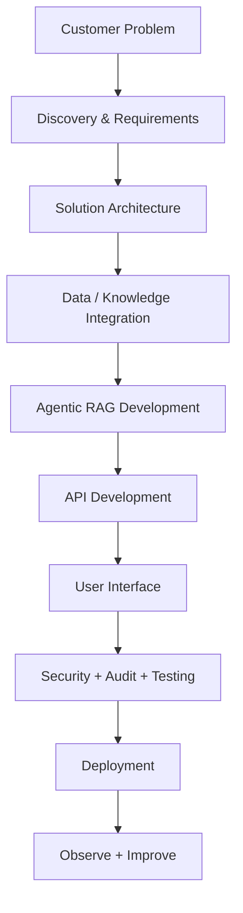
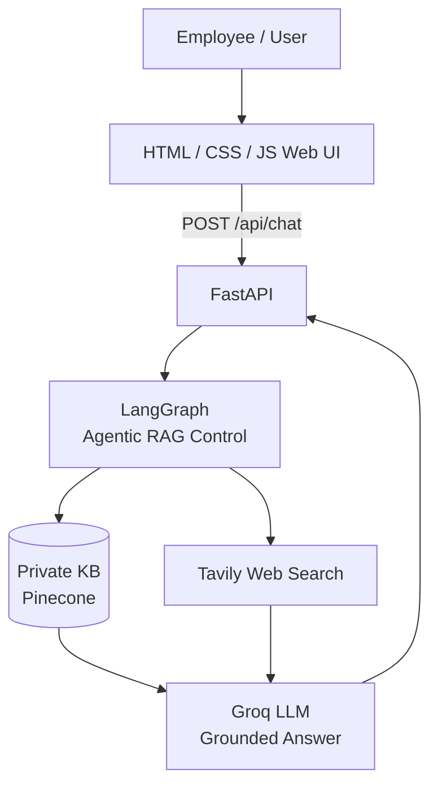
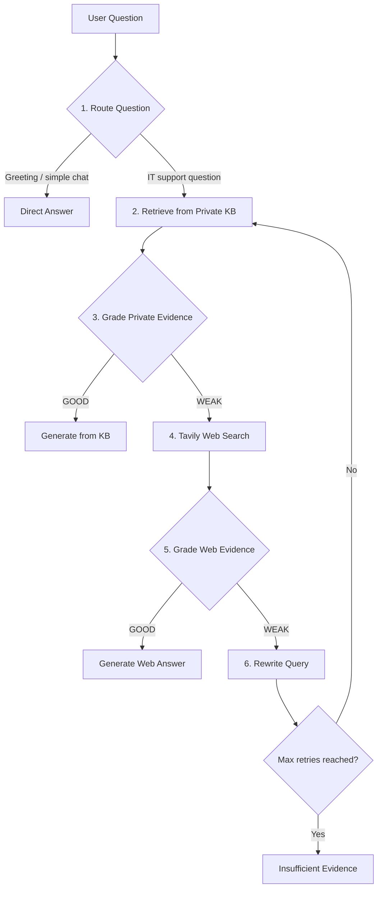
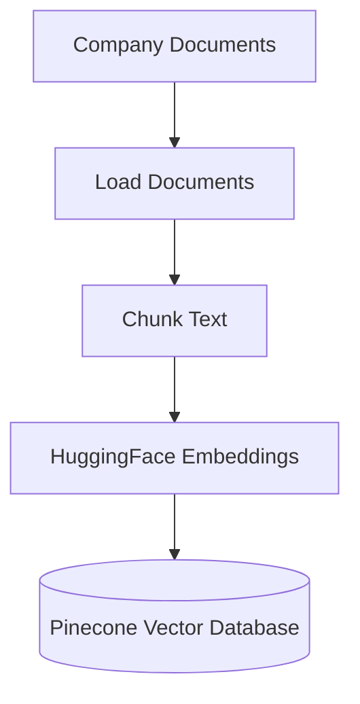
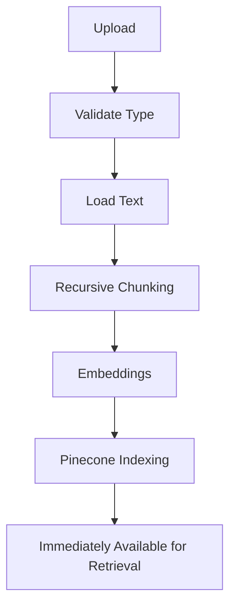

# 🛠️ Enterprise IT Support Agentic RAG Copilot

> An end-to-end **Forward Deployed Engineer (FDE)** project that turns a notebook-style Agentic RAG workflow into a deployable internal product.


**Stack:** LangGraph · FastAPI · Pinecone · Groq · Tavily · HTML / CSS / JavaScript

---

## Table of Contents

- [1. Business Problem](#1-business-problem)
- [2. Why This Is an FDE Project](#2-why-this-is-an-fde-project)
- [3. System Architecture](#3-system-architecture)
- [4. Agentic RAG Workflow](#4-agentic-rag-workflow)
- [5. Technology Stack](#5-technology-stack)
- [6. Project Structure](#6-project-structure)
- [7. Setup and Installation](#7-setup-and-installation)
- [8. Demo Scenarios](#8-demo-scenarios)
- [9. Document Upload Demo](#9-document-upload-demo)
- [10. API Endpoints](#10-api-endpoints)
- [11. Docker](#11-docker)
- [12. Acknowledgements](#12-acknowledgements)

---

## 1. Business Problem

### Customer

**STELLARIS Group** is a fictional retail company with 3,000 employees.

### Problem

The internal IT team maintains many documents, including:

- VPN instructions
- Password rules
- MFA policies
- Software installation rules
- Laptop troubleshooting guides
- Service-desk runbooks

Employees still create repetitive support tickets because:

- They do not know where to find the correct document.
- Traditional keyword search returns too many results.
- A conventional chatbot may hallucinate answers.
- Internal documents can be incomplete or outdated.
- Some questions require current vendor information from the public web.

### Example Use Cases

**Private knowledge-base question**

> How do I connect to the company VPN from home?

The answer exists in the private company knowledge base (KB), so the system should **not** search the public internet.

**Current-information question**

> What is the latest Microsoft Teams outage guidance?

The internal KB may not contain current outage information. The system should recognize weak private evidence, use an external search, grade that evidence, and answer with an external-source warning.

### Business Goal

Build a secure IT Support Copilot that:

- Searches trusted private knowledge first.
- Checks whether retrieved evidence is sufficient.
- Uses web search only when private knowledge is insufficient.
- Rewrites weak queries and retries retrieval.
- Generates grounded answers.
- Shows its decision path for transparency and debugging.
- Allows authorized staff to add new company documents.

---

## 2. Why This Is an FDE Project

A **Forward Deployed Engineer (FDE)** does more than build an LLM notebook. The FDE turns a customer's problem into a usable product.

### Project Lifecycle



This repository demonstrates each layer.

---

## 3. System Architecture



---

## 4. Agentic RAG Workflow

### Workflow Overview



### Why Agentic?

A conventional RAG pipeline generally follows:

```text
Question -> Retrieve -> Generate
```

This project adds decision-making steps:

```text
Question
   -> Route
   -> Retrieve
   -> Evaluate Evidence
   -> Choose KB or Web
   -> Rewrite if Needed
   -> Retry
   -> Generate Grounded Answer
```

The system therefore controls what to do next based on its current state.

---

## 5. Technology Stack

| Layer | Technology | Purpose |
|---|---|---|
| Agent workflow | LangGraph | Stateful routing and conditional decisions |
| LLM | Groq | Routing, grading, rewriting, and answer generation |
| Embeddings | HuggingFace `all-MiniLM-L6-v2` | Local 384-dimensional embeddings |
| Vector database | Pinecone | Private enterprise knowledge base |
| External search | Tavily | Fallback when company KB evidence is insufficient |
| API | FastAPI | Backend and REST endpoints |
| Frontend | HTML, CSS, JavaScript | Employee-facing interface |
| Audit | SQLite | Basic decision-path logging |
| Packaging | Docker | Reproducible deployment |

---

## 6. Project Structure

```text
FDE_Agentic_RAG_IT_Copilot/
│
├── app/
│   ├── api/
│   │   └── routes.py              # Chat, health, and ingestion APIs
│   │
│   ├── core/
│   │   ├── config.py              # Environment configuration
│   │   └── logging.py             # Logging configuration
│   │
│   ├── rag/
│   │   ├── state.py               # LangGraph state + structured decisions
│   │   ├── vectorstore.py         # Pinecone + embeddings
│   │   └── workflow.py            # Complete Agentic RAG graph
│   │
│   ├── services/
│   │   ├── audit.py               # SQLite query audit
│   │   └── ingestion.py           # PDF/TXT/MD/DOCX loading + chunking
│   │
│   └── main.py                    # FastAPI application
│
├── data/
│   └── sample_kb/
│       ├── company_it_handbook.md
│       └── service_desk_runbook.md
│
├── static/
│   ├── css/
│   │   └── style.css
│   └── js/
│       └── app.js
│
├── templates/
│   └── index.html
│
├── tests/
│   └── test_ingestion.py
│
├── uploads/
├── .env.example
├── Dockerfile
├── ingest_sample_kb.py
├── requirements.txt
├── run.py
└── README.md
```

---

## 7. Setup and Installation

### Prerequisites

- Python 3.10+
- A [Pinecone](https://www.pinecone.io/) account and API key
- A [Groq](https://groq.com/) API key
- A [Tavily](https://tavily.com/) API key
- An [OpenAI](https://openai.com/) API key (optional fallback LLM)

### Step 1: Clone the repository and create a virtual environment

```bash
git clone https://github.com/<your-username>/<your-repo-name>.git
cd <your-repo-name>

python -m venv venv
```

**Windows (Command Prompt):**

```bat
venv\Scripts\activate
```

**macOS / Linux:**

```bash
source venv/bin/activate
```

### Step 2: Install dependencies

```bash
pip install -r requirements.txt
```

### Step 3: Configure environment variables

Copy the example file and fill in your own keys:

```bash
cp .env.example .env
```

Your `.env` should look like this:

```dotenv
# LLM API Keys
GROQ_API_KEY=your_groq_api_key_here
OPENAI_API_KEY=your_openai_api_key_here

# External Search
TAVILY_API_KEY=your_tavily_api_key_here

# Vector Database (Pinecone)
PINECONE_API_KEY=your_pinecone_api_key_here
PINECONE_INDEX_NAME=fde-it-support-rag
PINECONE_NAMESPACE=company-it-kb

# Models
GROQ_MODEL=openai/gpt-oss-20b
OPENAI_MODEL=gpt-4o-mini
EMBEDDING_MODEL=sentence-transformers/all-MiniLM-L6-v2

# Security
ADMIN_API_KEY=change-me-in-production

# Application Settings
ACCOUNT_HOLDER_NAME=Employee Name
COMPANY_NAME=Stellaris Group
APP_ENV=development
```

### Environment Variable Reference

| Variable | Description | Example | Required |
|---|---|---|---|
| `GROQ_API_KEY` | API key for Groq LLM (routing, grading, generation) | `gsk_...` | Yes |
| `OPENAI_API_KEY` | API key for OpenAI (fallback LLM) | `sk-...` | Optional |
| `TAVILY_API_KEY` | API key for Tavily web search | `tvly-...` | Yes |
| `PINECONE_API_KEY` | API key for Pinecone vector database | `pckey-...` | Yes |
| `PINECONE_INDEX_NAME` | Pinecone index name | `fde-it-support-rag` | Optional (default: `fde-it-support-rag`) |
| `PINECONE_NAMESPACE` | Pinecone namespace for document isolation | `company-it-kb` | Optional (default: `company-it-kb`) |
| `GROQ_MODEL` | Groq model identifier | `openai/gpt-oss-20b` | Optional (default: `openai/gpt-oss-20b`) |
| `OPENAI_MODEL` | OpenAI model identifier | `gpt-4o-mini` | Optional (default: `gpt-4o-mini`) |
| `EMBEDDING_MODEL` | Embedding model for vectorization | `sentence-transformers/all-MiniLM-L6-v2` | Optional |
| `ADMIN_API_KEY` | Secret key for admin endpoints (document ingestion) | `your-secure-key` | Required for ingestion; if unset, admin access is disabled |
| `ACCOUNT_HOLDER_NAME` | Name displayed in the account profile (not used as the company or KB name) | `Employee Name` | Optional |
| `COMPANY_NAME` | Company name used in generated KB answers | `Stellaris Group` | Optional (default: `Stellaris Group`) |
| `APP_ENV` | Application environment | `development` or `production` | Optional (default: `development`) |

> [!WARNING]
> **Security notes**
>
> - Never commit `.env` to version control. Add it to `.gitignore`.
> - Change `ADMIN_API_KEY` to a secure random value in production.
> - Use environment variables instead of hardcoding secrets.
> - Restrict API key access to only the services that need them.

### Step 4: Load the sample company knowledge

```bash
python ingest_sample_kb.py
```

This demonstrates the RAG ingestion pipeline:



### Step 5: Run the application

```bash
python run.py
```

Open the application:

- **Web UI:** <http://127.0.0.1:8000>
- **FastAPI API documentation:** <http://127.0.0.1:8000/docs>

---

## 8. Demo Scenarios

### Demo A: Private KB Success

**Ask:**

> How do I connect to the company VPN from home?

**Expected path:**

```text
Router -> KB
Private KB Retrieval
KB Grade -> GOOD
Generate from Private KB
```

**Teaching point:** Trusted internal company knowledge is preferred. No public web call is necessary.

### Demo B: Company Policy Question

**Ask:**

> Can IT support ask me to share my MFA code?

The internal handbook says employees must never share passwords or MFA codes with support personnel.

**Expected path:**

```text
Router -> KB
Private KB Retrieval
KB Grade -> GOOD
Private KB Answer
```

**Teaching point:** RAG allows the model to answer using company-specific information it was never trained on.

### Demo C: External / Current Information

**Ask:**

> What is the latest Microsoft Teams outage guidance?

**Expected path when internal documents do not answer the question:**

```text
Router -> KB
Private KB Retrieval
KB Grade -> WEAK
Tavily Search
Web Grade -> GOOD
Web Answer
```

**Teaching point:** Agentic RAG can choose another information source rather than blindly answering from irrelevant vectors.

### Demo D: Query Rewrite

**Ask a deliberately vague question, such as:**

> My work communication app is acting strange after the new update. What should I do?

If both the KB and the first external retrieval are weak, the workflow can rewrite the query and retry.

**Teaching point:** Retrieval failure does not immediately mean failure. An agent can improve the search query and try again, while a retry guard avoids infinite loops.

### Demo E: Direct Conversation

**Ask:**

> Hello!

**Expected path:**

```text
Router -> DIRECT
Direct Answer
```

**Teaching point:** Not every message should trigger an expensive vector search or web search.

---

## 9. Document Upload Demo

The sidebar contains **Add Company Document**. Use the `ADMIN_API_KEY` from your `.env`.

Supported file types:

- `.pdf`
- `.txt`
- `.md`
- `.docx`

### Upload Workflow



This is useful in an FDE demonstration because the customer does not want to edit Python every time a new policy is published.

---

## 10. API Endpoints

### `GET /api/health`

Health check.

### `POST /api/chat`

Send a question to the copilot.

**Example request:**

```json
{
  "question": "How do I reset my company password?"
}
```

**Example response:**

```json
{
  "answer": "...",
  "source_used": "private_kb",
  "trace": [
    "Router -> KB",
    "Private KB retrieval -> 4 chunks",
    "KB evidence grade -> GOOD",
    "Answer generation -> PRIVATE KB"
  ],
  "citations": []
}
```

### `POST /api/ingest`

Uploads a document and adds its chunks to Pinecone.

When **Upload & Ingest** is clicked, the UI first checks the provided admin key with `POST /api/admin/verify`. The document is sent to `/api/ingest` only after that check succeeds. Configure `ADMIN_API_KEY` in the deployment environment; if it is unset, document ingestion is disabled.

---

## 11. Docker

```bash
docker build -t it-support-copilot .
docker run -p 8000:8000 --env-file .env it-support-copilot
```

Then open <http://127.0.0.1:8000>.

---

## 12. Acknowledgements

This project closely follows the end-to-end Agentic RAG production tutorial by **DSwithBappy** on YouTube. I learned the core workflow design, the LangGraph-based routing and grading pattern, and the notebook-to-product approach from his content, then adapted it into this FDE-style IT Support Copilot for the fictional STELLARIS Group.

Huge thanks to **DSwithBappy** for the clear, practical teaching. If you want to learn how to build production-grade Agentic RAG systems, go check out his channel.
